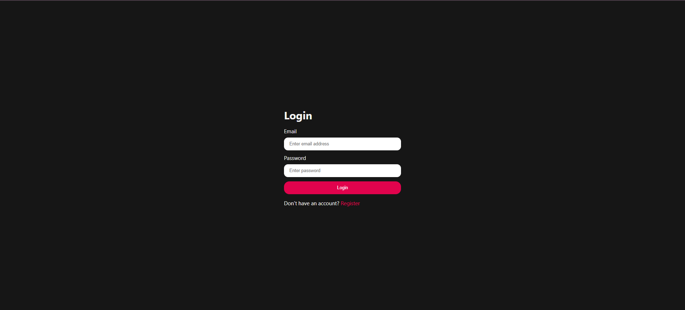
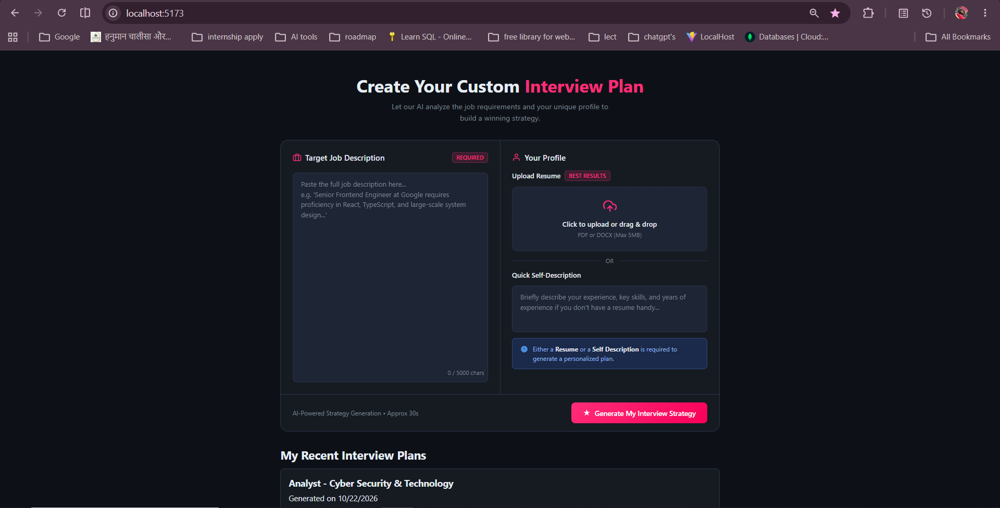
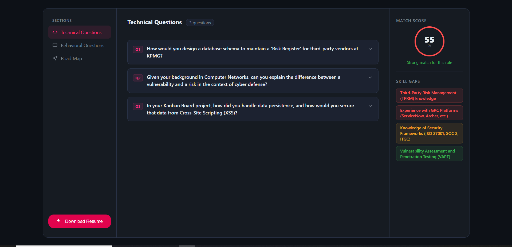
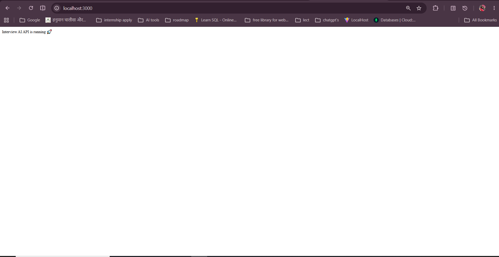

# Interview AI

An AI-powered interview preparation app. Upload your resume (PDF), paste a job description, and get a personalised interview report: a match score, skill gaps, technical and behavioural questions tailored to you, and a preparation road map.

Built with the **MERN stack** and **Google Gemini**.

> Based on the tutorial project [ankurdotio/interview-ai-yt](https://github.com/ankurdotio/interview-ai-yt). I cloned it to learn from it and extended it with my own changes (see [My Changes](#my-changes)).

---

## Features

- **User authentication**: register, log in and log out with JWT-based auth
- **Resume analysis**: upload a resume (PDF or DOCX, max 5 MB) or write a short self-description, and compare it against a job description
- **Match score**: see how well your profile fits the role
- **Skill gap analysis**: highlights the skills you are missing, ranked by severity
- **Technical questions**: questions generated from your background and the job role
- **Behavioural questions**: practice questions for the soft-skills round
- **Preparation road map**: a step-by-step plan to close your gaps
- **Download resume**: export a tailored resume from the report
- **Recent interview plans**: every report is stored in MongoDB and listed on the home page so it can be reopened later

## Tech Stack

| Layer | Technologies |
| --- | --- |
| Frontend | React, Vite, Axios |
| Backend | Node.js, Express |
| Database | MongoDB Atlas, Mongoose |
| Auth | JSON Web Tokens (JWT) |
| File upload | Multer |
| AI | Google Gemini API (`@google/genai`) |

## Project Structure

```
interview-ai/
├── Backend/
│   ├── src/
│   │   ├── config/        # Database connection
│   │   ├── controllers/   # Request handlers
│   │   ├── middlewares/   # Auth and upload middleware
│   │   ├── models/        # Mongoose schemas
│   │   ├── routes/        # API routes
│   │   ├── services/      # Gemini AI logic
│   │   └── app.js
│   └── server.js
└── Frontend/
    ├── public/
    ├── src/
    ├── index.html
    └── vite.config.js
```

## Getting Started

### Prerequisites

- [Node.js](https://nodejs.org/) (v18 or later)
- A [MongoDB Atlas](https://www.mongodb.com/atlas) cluster (or a local MongoDB)
- A Gemini API key from [Google AI Studio](https://aistudio.google.com/apikey)

### 1. Clone the repository

```bash
git clone https://github.com/mansi-0603/interview-ai.git
cd interview-ai
```

### 2. Set up the backend

```bash
cd Backend
npm install
```

Create a `.env` file inside `Backend/`:

```env
MONGO_URI=your_mongodb_connection_string
JWT_SECRET=any_long_random_string
GOOGLE_GENAI_API_KEY=your_gemini_api_key
```

> The variable names must match the ones used in the code (`src/config/database.js`, the auth files and `src/services/ai.service.js`). Never commit your `.env` file.

Start the server:

```bash
npm run dev
```

The API runs on `http://localhost:3000`.

### 3. Set up the frontend

In a second terminal:

```bash
cd Frontend
npm install
npm run dev
```

The app runs on `http://localhost:5173`.

## How It Works

1. The user registers or logs in and receives a JWT.
2. The user uploads a PDF resume and enters a job description.
3. The backend reads the PDF with Multer and sends the resume text and job details to Gemini.
4. Gemini returns a structured report (score, skill gaps, questions, road map).
5. The report is saved to MongoDB and displayed in the UI.

## API Overview

| Method | Endpoint | Description |
| --- | --- | --- |
| POST | `/api/auth/register` | Create an account |
| POST | `/api/auth/login` | Log in |
| GET | `/api/auth/get-me` | Get the logged-in user |
| POST | `/api/interview/` | Generate an interview report |

> Endpoints may vary slightly; check `Backend/src/routes` for the full list.

## My Changes

- Fixed the MongoDB connection environment variable handling
- Set up my own MongoDB Atlas database and Gemini API key
- _Add your own features here (for example: report history dashboard, mock-interview mode, deployment)_

## Screenshots

### Login Page



### Home Page: Create Your Interview Plan



### Interview Report



### Backend API Running



## License

MIT LIcense
